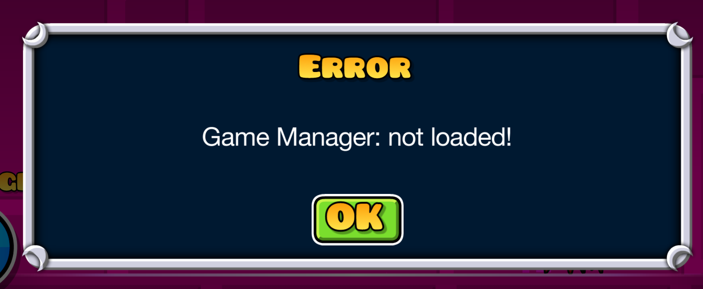
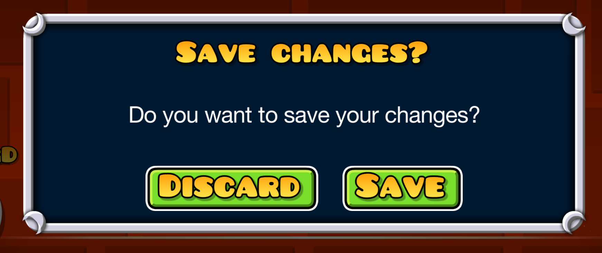
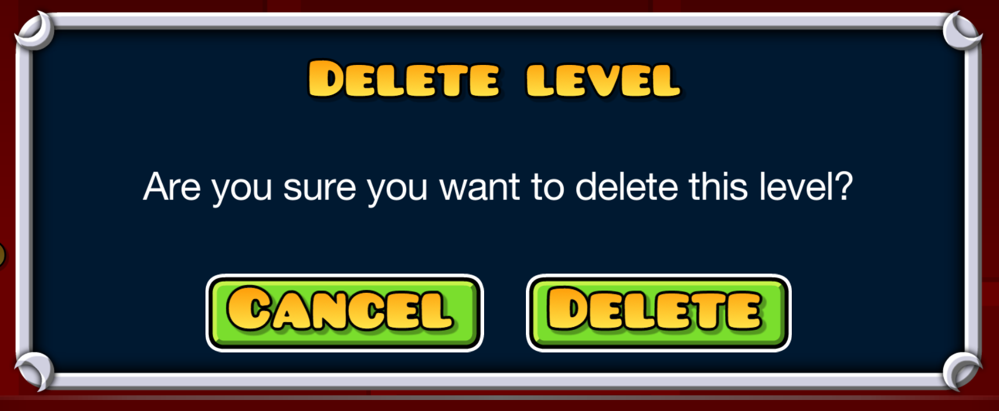
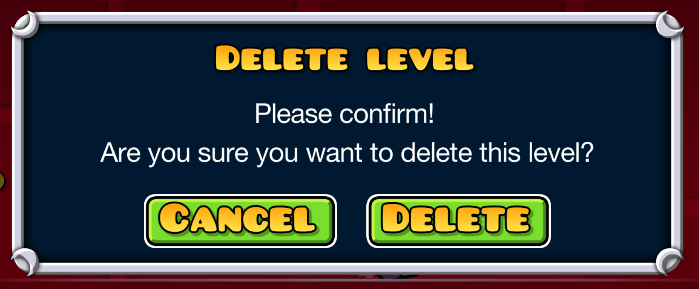
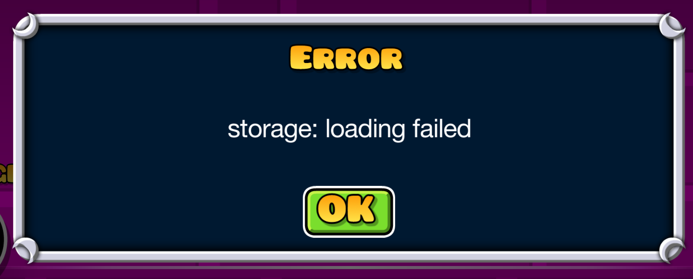

# Dialogs

```cpp
#include <lpui/ui/Dialogs.hpp>
```

These helpers live in `lpui::Dialogs` and queue their popups through Geode’s `PopupManager`.

For confirmation dialogs and `askSaveChanges`, Escape dismisses the prompt without running its callback. For `askChoice`, Escape counts as choosing the left button.

Supply nonempty callbacks. Queuing a dialog does not retain objects captured by raw pointer, so make sure anything used by a callback is still alive when it runs.

- [showMessage](#showmessage)
- [showError](#showerror)
- [askSaveChanges](#asksavechanges)
- [askConfirm](#askconfirm)
- [askConfirmDelete](#askconfirmdelete)
- [askChoice](#askchoice)
- [handleResult](#handleresult)

## showMessage

```cpp
void showMessage(std::string_view title, std::string const& text, std::optional<float> width = std::nullopt);
```

Queues an alert with an `OK` button. The message supports color tags; omit `width` to use `PopupManager::DEFAULT_WIDTH`.

```cpp
lpui::Dialogs::showMessage("Level Stats", "<cg>Attempts:</c> 42");
```

## showError

```cpp
void showError(std::string_view context, std::string const& err);
```

Queues an alert titled `Error`, with the message `context: err`.

```cpp
lpui::Dialogs::showError("Game Manager", "not loaded!");
```



## askSaveChanges

```cpp
void askSaveChanges(std::function<geode::Result<>()> onSave, std::string_view errorContext, std::function<void()> onClose);
```

Asks whether to save changes before closing. `Discard` calls `onClose`. `Save` calls `onSave`, then calls `onClose` only if saving succeeds. A save error is shown with `errorContext`.

If `onSave` returns an error, the helper shows it and leaves the editor open. This does not reopen the save prompt. Escape dismisses the prompt and leaves the editor open without saving or discarding.

```cpp
void onClose(CCObject* sender) override {
    if (!hasChanges())
        return Popup::onClose(sender);

    lpui::Dialogs::askSaveChanges([this]() {
        return save();
    }, "Failed to save", [this, sender]() {
        Popup::onClose(sender);
    });
}
```



## askConfirm

```cpp
void askConfirm(std::string_view title, std::string_view text, std::string_view confirmLabel, std::function<void()> onConfirm);
```

Shows `Cancel` and a button named by `confirmLabel`. Only the second button calls `onConfirm`.

```cpp
lpui::Dialogs::askConfirm("Update level pack", "Update it?", "Update", []() {
    // update here
});
```

## askConfirmDelete

```cpp
void askConfirmDelete(std::string_view what, std::function<void()> onConfirm, std::string_view details = {});
```

Shows `Cancel` and `Delete`, with title `Delete <what>` and question `Are you sure you want to delete this <what>?`. Only `Delete` calls `onConfirm`. If supplied, `details` appears on a line above the question.

```cpp
lpui::Dialogs::askConfirmDelete("level", []() {
    // delete level here
});
```



With `details`:

```cpp
lpui::Dialogs::askConfirmDelete("level", []() {
    // delete level here
}, "Please confirm!");
```



## askChoice

```cpp
void askChoice(
    std::string_view title, std::string_view text, std::string_view firstLabel, std::string_view secondLabel,
    std::function<void(bool secondChosen)> onChoice, bool persistent = false
);
```

Calls `onChoice(false)` for the left button and `onChoice(true)` for the right button. Escape also calls `onChoice(false)`. Set `persistent = true` to keep the popup across scene changes.

```cpp
lpui::Dialogs::askChoice("Level pack updated", "Reset progress?", "Keep", "Reset", [](bool reset) {
    // reset or keep here
}, true);
```

## handleResult

```cpp
void handleResult(geode::Result<> res, std::string_view errorContext, std::function<void()> onOk);
```

On error, queues a message through `showError`. On success, calls `onOk` immediately.

```cpp
geode::Result<> res = geode::Err("loading failed");

lpui::Dialogs::handleResult(res, "storage", []() {
    // will be called if res is Ok, and no error alert will be shown
});
```



Use it with [`SaveCallback`](utils.md#callbacks) when an editor should close only after its owner successfully saves the changes.
