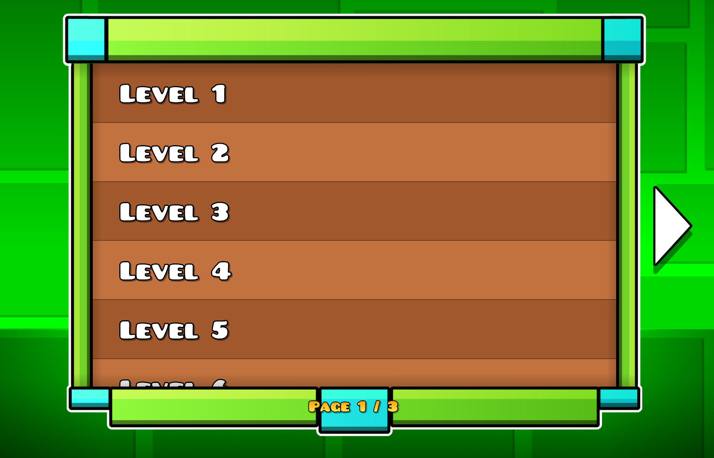
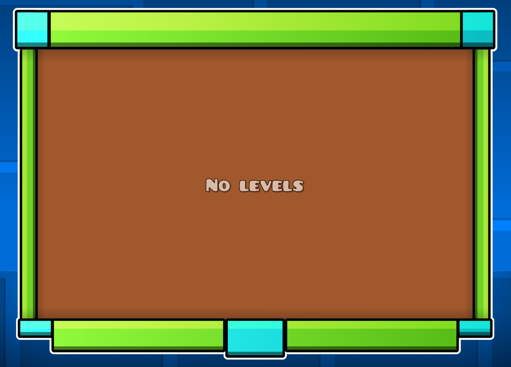
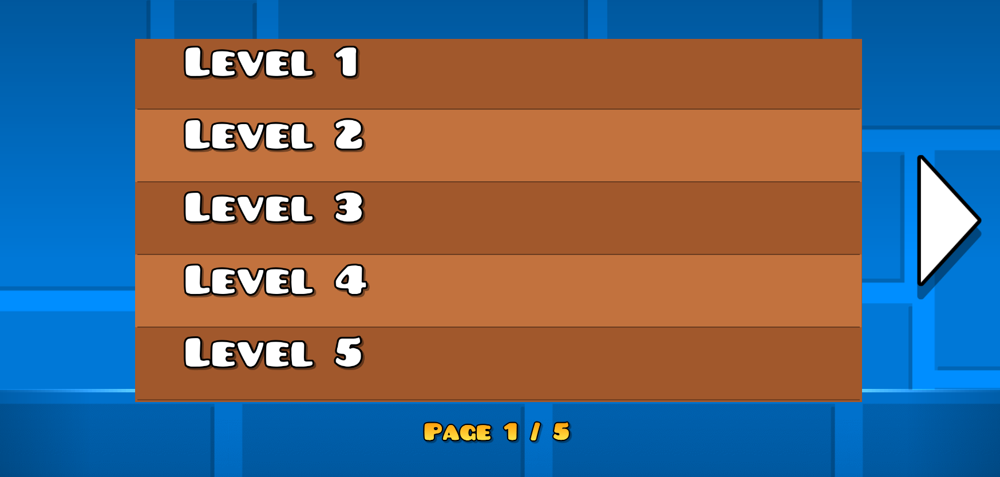
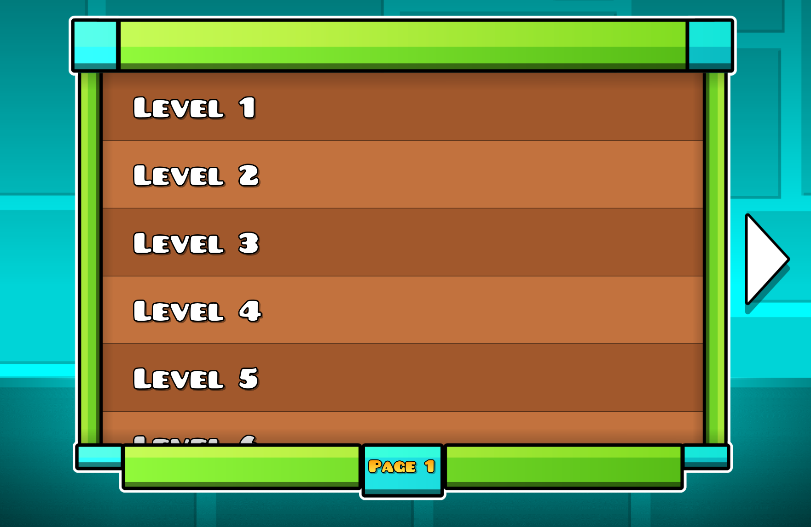

# Lists

- [ListFrame](#listframe)
- [PagedList](#pagedlist)
  - [Source](#source)
  - [Methods](#methods)
  - [Unknown total](#unknown-total)

## ListFrame

```cpp
#include <lpui/ui/nodes/ListFrame.hpp>

static lpui::ListFrame* lpui::ListFrame::create(float height);
```

A frame built from the standard GD list textures, with anchor point `{0.5, 0.5}`.

Only the height can be chosen: the top and bottom textures don't stretch, so the width is always `ListFrame::Width` (`358`).

```cpp
auto listFrame = lpui::ListFrame::create(220.f);
this->addChild(listFrame);
```


## PagedList

```cpp
#include <lpui/ui/nodes/PagedList.hpp>

static lpui::PagedList* lpui::PagedList::create(float height, Options options);
static lpui::PagedList* lpui::PagedList::create(cocos2d::CCSize size, Options options);
```

A list with page arrows and a `Page N / M` label. You provide a [source](#source) that builds the rows for each requested page. The source can read local data or load it asynchronously. The list retains the displayed row nodes; the source owns the underlying data. Anchor point is `{0.5, 0.5}`.

- `create(height, options)` draws a [`ListFrame`](#listframe) around the list, so the width is `ListFrame::Width`.
- `create(size, options)` uses the supplied size and draws no frame.

| Option         | Description |
|----------------|-------------|
| `emptyText`    | text shown in the middle when the page is empty, nothing is shown if empty |
| `itemsPerPage` | rows per page; defaults to `10`, values below `1` become `1` |
| `itemHeight`   | height of one row, `40` by default |

Leave room around the list: the arrows sit `36` units beyond its sides, and the page label sits `12` units below it. An arrow is hidden when there is no page in that direction. While loading, both arrows and the page label are hidden, and a spinner appears over the current rows. The label is also hidden when the known page count is zero or one.

```cpp
#include <lpui/ui/nodes/PagedList.hpp>
#include <lpui/utils/Create.hpp>
#include <algorithm>
#include <string>
#include <vector>

using namespace geode::prelude;

class MyLayer : public CCLayer, public lpui::PagedListSource {
protected:
    std::vector<std::string> m_names;
    lpui::PagedList* m_list = nullptr;

    bool init() override {
        if (!CCLayer::init()) return false;

        for (int i = 1; i <= 25; ++i)
            m_names.push_back(fmt::format("Level {}", i));

        m_list = lpui::PagedList::create(220.f, {.emptyText = "No levels"});
        m_list->setPosition(CCDirector::get()->getWinSize() * 0.5f);
        this->addChild(m_list);
        m_list->setSource(this);

        return true;
    }

    void loadItems(lpui::PageRequest request) override {
        int last = std::min(request.first + request.count, static_cast<int>(m_names.size()));

        auto items = CCArray::create();
        for (int i = request.first; i < last; ++i) {
            auto label = CCLabelBMFont::create(m_names[i].c_str(), "bigFont.fnt");
            label->setScale(0.6f);
            label->setPosition({20.f, 20.f});
            label->setAnchorPoint({0.f, 0.5f});

            auto cell = CCNode::create();
            cell->addChild(label);
            items->addObject(cell);
        }

        request.respond({items, static_cast<int>(m_names.size())});
    }

public:
    static MyLayer* create() {
        auto ret = new MyLayer();
        return lpui::finishCreate(ret, ret->init());
    }
};
```



With no names, the list shows `emptyText`:



Smaller list without a frame:

```cpp
auto list = lpui::PagedList::create(CCSize{300.f, 150.f}, {
    .itemsPerPage = 5,
    .itemHeight = 30.f,
});
```



### Source

```cpp
class lpui::PagedListSource {
public:
    virtual ~PagedListSource() = default;
    virtual void loadItems(lpui::PageRequest request) = 0;
};

class lpui::PageRequest {
public:
    int first;
    int count;

    void respond(lpui::PageResponse response) const;
};

struct lpui::PageResponse {
    cocos2d::CCArray* items = nullptr;
    std::optional<int> total;
};
```

The source is set with `setSource`. The list calls `loadItems` every time it needs a page, and the source answers with `request.respond(...)`.

| `PageRequest` | Description |
|---------------|-------------|
| `first`       | index of the first item of the page |
| `count`       | how many items are needed, equals `itemsPerPage` |
| `respond`     | gives the page to the list |

| `PageResponse` | Description |
|----------------|-------------|
| `items`        | nodes for the rows, at most `count`. `nullptr` is treated as an empty page |
| `total`        | total number of items in all pages, if known. See [Unknown total](#unknown-total) |

Requests and ownership:

- You can respond during `loadItems` or copy the request and respond later. Create row nodes and call `respond` on the main thread; it updates the UI directly. Leave `first` and `count` unchanged.
- Only the response to the latest request is used. If the user switched pages while the previous one was loading, the old response is ignored.
- A request holds a weak reference to the list. If the list has been destroyed, `respond` does nothing.
- The list doesn't own the source. It must stay alive while it is set, and usually the layer or popup with the list is the source itself, like in the example above.
- If a response shows that the requested page no longer exists, the list keeps the displayed page when that page is still in range and differs from the requested one. It updates the total and controls but leaves the displayed rows as they are. Otherwise, it requests the last remaining page. If the total is zero, it uses page index `0`.
- When a new page is shown, the items of the old one are removed with cleanup. Return new nodes for every request instead of reusing old ones.

### Methods

| Method | Description |
|--------|-------------|
| `void setSource(PagedListSource* source)` | sets the source and loads the first page. `nullptr` clears the list |
| `void reload(bool keepScroll = false)` | requests the current page again. with `keepScroll`, preserves the offset from the top when the displayed page stays the same, limited to the new scroll range |
| `void scheduleReload(bool keepScroll = false)` | defers a reload to the next scheduler tick and combines pending calls into one. Scroll is kept only if every combined call asks for it. Use this from row callbacks: a synchronous `reload` can remove the row while its callback is running |
| `void reset()` | forgets `total` and loads the first page, e.g. after a new search |
| `bool goToPage(int page)` | requests a page by zero-based index. Negative indices become `0`; a known total also limits the upper bound. Returns `false` without a source, or when the target is already displayed and no request is pending |
| `bool goToLastPage()` | requests the last page using the currently known total. Returns `false` if the total is unknown, the list is empty, or that page is already displayed with no request pending |
| `bool nextPage()`, `bool previousPage()` | request the adjacent page. Unlike clicks on the arrows, these calls are allowed while loading or while navigation is hidden |
| `void setItemsPerPage(int itemsPerPage)` | changes the page size (at least `1`) and requests the page containing the old page’s first item. Does nothing if the size is unchanged |
| `void setNavigationEnabled(bool enabled)` | allows or hides the arrows. Programmatic navigation remains available |
| `CCArray* getItems() const` | borrowed array of the displayed row nodes |
| `int getCurrentPage() const` | displayed page index, from `0`; stays unchanged while another page loads |
| `int getItemsPerPage() const` | page size |
| `std::optional<int> getTotal() const` | total number of items, if known |
| `std::optional<int> getPageCount() const` | number of pages, if `total` is known |
| `bool hasNextPage() const`, `bool hasPreviousPage() const` | whether the current page has a neighbour according to the known total. `hasNextPage()` returns `true` while the total is unknown |
| `bool isLoading() const` | whether the list is waiting for `respond` |

With the synchronous source above, you can add a row and open the last page:

```cpp
void onAddLevel(CCObject*) {
    m_names.push_back("New level");
    m_list->reload();
    m_list->goToLastPage();
}
```

This sequence relies on `reload()` completing immediately. With an asynchronous source, `goToLastPage()` would still use the old total. Wait until the new response has been applied before navigating. A successful navigation return value means a request was started, not that it has finished.

### Unknown total

If the source does not know the total, leave `PageResponse::total` empty. After `setSource()` or `reset()`:

- a full page (`count` rows) leaves the total unknown, so the right arrow stays visible and the label shows `Page N`;
- a shorter page sets the total to `request.first + receivedRows`.

Omitting `total` does not automatically clear a previously known total. A full page keeps that total unless its rows extend beyond it; a shorter page replaces it with the inferred value. Call `reset()` when starting a different search. Return an explicit total when you know it, especially if the data may shrink between requests.

To try a delayed response, queue it on the main thread and leave out the total:

```cpp
void loadItems(lpui::PageRequest request) override {
    auto names = m_names;
    Loader::get()->queueInMainThread([request, names = std::move(names)] {
        int last = std::min(request.first + request.count, static_cast<int>(names.size()));

        auto items = CCArray::create();
        for (int i = request.first; i < last; ++i) {
            auto label = CCLabelBMFont::create(names[i].c_str(), "bigFont.fnt");
            label->setScale(0.6f);
            label->setPosition({20.f, 20.f});
            label->setAnchorPoint({0.f, 0.5f});

            auto cell = CCNode::create();
            cell->addChild(label);
            items->addObject(cell);
        }

        request.respond({items});
    });
}
```


